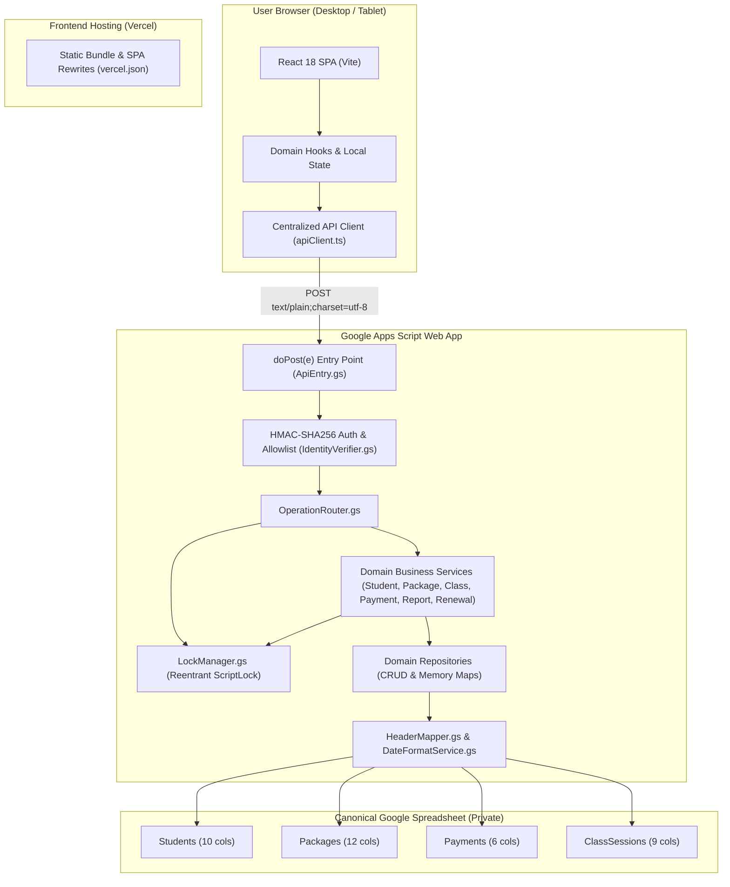
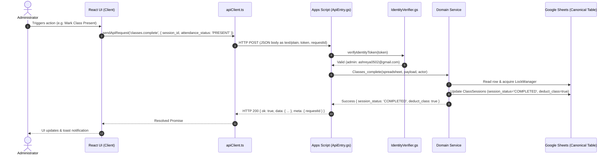
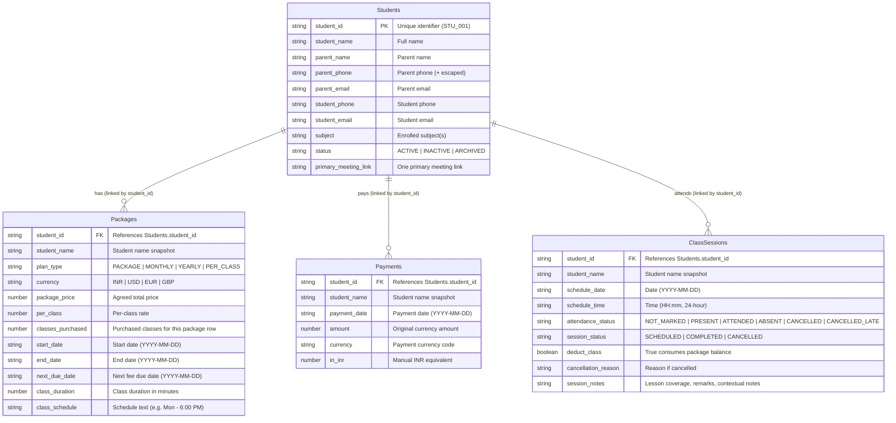
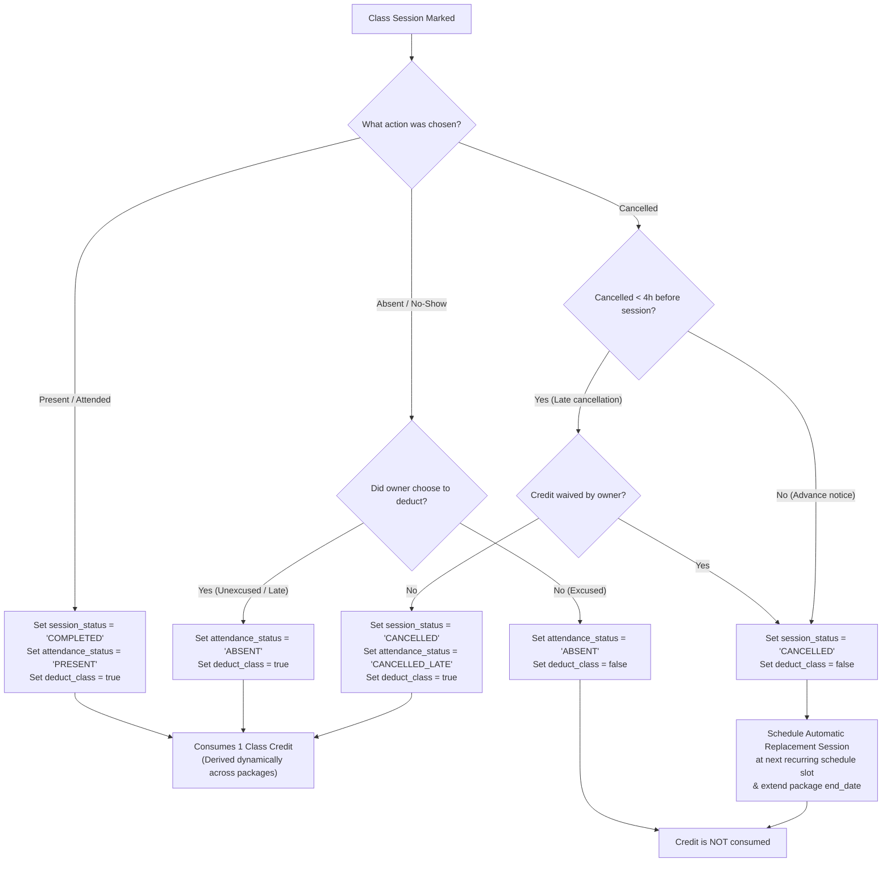

# 02 — System Architecture

## 1. Document Control

- **Product:** Personal Dashboard (Student Management Dashboard)
- **Document ID:** 02
- **Status:** Authoritative Architecture Specification
- **Version:** 5.0.0 (Canonical Four-Table Architecture)
- **Last Verified Date:** 2026-11-17
- **Audience:** Developers, architects, AI coding agents

---

## 2. Architectural Principles & Stack

1. **Frontend-Backend Separation:**
   - **Frontend:** React 18, TypeScript, and Vite. Static single-page application hosted on Vercel.
   - **Backend:** Google Apps Script (GAS) Web App deployed as an executable API endpoint.
   - **Datastore:** Exactly FOUR physical Google Sheets tables in a single private Google Spreadsheet.
2. **Strict Datastore Boundary:**
   - The browser never communicates directly with the Google Sheets API.
   - All spreadsheet reads and mutations pass through the authenticated Apps Script Web App.
3. **Zero-GCP Authentication:**
   - No Google Cloud Console, GCP project, OAuth consent screen, or OAuth credentials are required.
   - Session authentication uses server-side HMAC-SHA256 tokens signed with `ADMIN_AUTH_KEY` stored in Apps Script `ScriptProperties`.
4. **Transport via CORS-Free Text/Plain POST:**
   - The frontend issues HTTP POST requests with `Content-Type: text/plain;charset=utf-8` and `redirect: 'follow'`.
   - Using `text/plain` prevents CORS preflight (`OPTIONS`) requests, which Google Apps Script Web Apps cannot answer.
5. **Micro-File Architecture:**
   - Every source file in `src/` and `public/` is strictly $\le 149$ lines, organized by single-responsibility domains.

---

## 3. High-Level Architecture Diagram

---

## 4. Request & Response Lifecycle Flow

---

## 5. Domain Relationship Diagram

The canonical datastore contains **strictly four tables** with all secondary records linking directly to `Students.student_id`.

---

## 6. Attendance & Class Deduction Workflow

---

## 7. Package Renewal & Class Balance Derivation Architecture

### 7.1 Historical Package Preservation
When a package is renewed (`packages.renew` / `students.renew`):
1. **No Overwrite:** The historical package row is preserved untouched in `Packages`.
2. **New Row Appended:** A new package row is appended with the new package purchase details (`classes_purchased = newClasses`, `package_price = newPrice`, `start_date`, `end_date`, `class_schedule`).
3. **Aggregate Balance Derivation:** Student available class balance is dynamically derived across all packages:
   $$\text{Total Purchased} = \sum_{p \in \text{Packages}, p.\text{student\_id} = \text{sid}} p.\text{classes\_purchased}$$
   $$\text{Total Consumed} = \sum_{s \in \text{ClassSessions}, s.\text{student\_id} = \text{sid}, s.\text{deduct\_class} = \text{true}} 1$$
   $$\text{Remaining Available Balance} = \text{Total Purchased} - \text{Total Consumed}$$

---

## 8. Schedule Persistence & Concurrency Safeguards

1. **Storage Location:** Recurring schedules are persisted directly in `Packages.class_schedule`.
2. **Shared ScriptLock:** All conflicting writers to `Packages.class_schedule` (including `Schedules_save` and `RenewalService`) acquire the shared script lock via `LockManager.withLock(fn, timeoutMs)`.
3. **Reentrant Lock Support:** `LockManager.withLock` tracks execution-local lock depth. Nested calls within the same execution context (e.g. `RenewalService` calling `Schedules_save`) execute without self-deadlock, while ensuring the underlying Google Apps Script `ScriptLock` is acquired and released at depth 1.
4. **Lock Acquisition Failure:** If lock cannot be acquired within the timeout window, the write operation is safely aborted with `LOCK_TIMEOUT` and zero mutations occur.

---

## 9. Payment Safety & Void Mechanics

1. **6-Column Schema:** `student_id, student_name, payment_date, amount, currency, in_inr`.
2. **Idempotency:** Payment recording utilizes client-supplied `idempotency_key` cached in memory and durable store. Duplicate retries return the original record.
3. **Physical Row Deletion on Void:** Payments does not have a physical status column. Voiding locates the specific payment row and physically removes it via `sheet.deleteRow()`.
4. **Durable Tombstone:** A tombstone is recorded in `ScriptProperties` (`payment_void_<id>`). If a void request is retried, the tombstone prevents re-processing and safely returns idempotent success.
5. **Ambiguity Prevention:** If multiple identical rows exist that match the student, amount, and date without unique discrimination, `Payments_void` rejects with `AMBIGUOUS_RECORD` to avoid deleting the wrong row.
